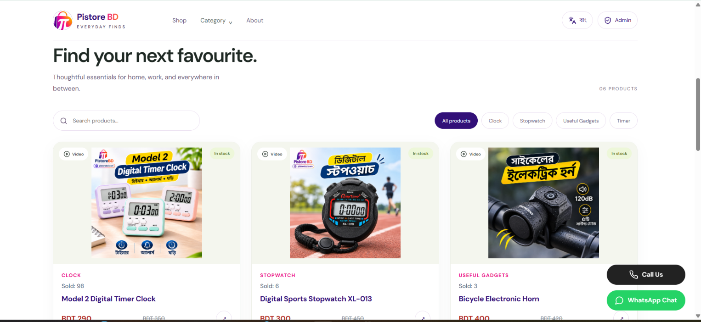

# Pistore BD — E-commerce Platform

A real-world e-commerce platform developed for an online gadgets and accessories business.

🌐 **Live Website:** https://www.pistorebd.com/

## About the Project

## Project Preview

🌐 [Visit Live Website](https://www.pistorebd.com/)

Pistore BD is an e-commerce platform designed to support online retail operations and improve the digital shopping experience.

The project focuses on practical software development, database integration, product management, and business operations.

## Technology Stack

- React
- Vite
- JavaScript
- Supabase
- Vercel

## Key Features

- Product catalog and management
- Product variants and specifications
- Customer review system
- Shopping cart
- Sales management
- Inventory management
- Administrative dashboard
- SEO and website analytics

## Development Highlights

- Built for a real-world business.
- Integrated Supabase for database services.
- Deployed using Vercel.
- Implemented website analytics and SEO improvements.
- Continuously maintained and improved.

## Project Architecture

| Component | Technology |
|---|---|
| Frontend | React + Vite |
| Backend Services | Supabase |
| Database | Supabase |
| Hosting | Vercel |

## Source Code

The original application source code is maintained in a private repository. This public repository serves as a project showcase and documentation.

## Project Status

Ongoing Development

## Developer

**Imzamam Haque**

Computer Science and Technology Student

GitHub: https://github.com/byimzamam

Website: https://www.pistorebd.com/

---

*Developed as a practical real-world software project.*
